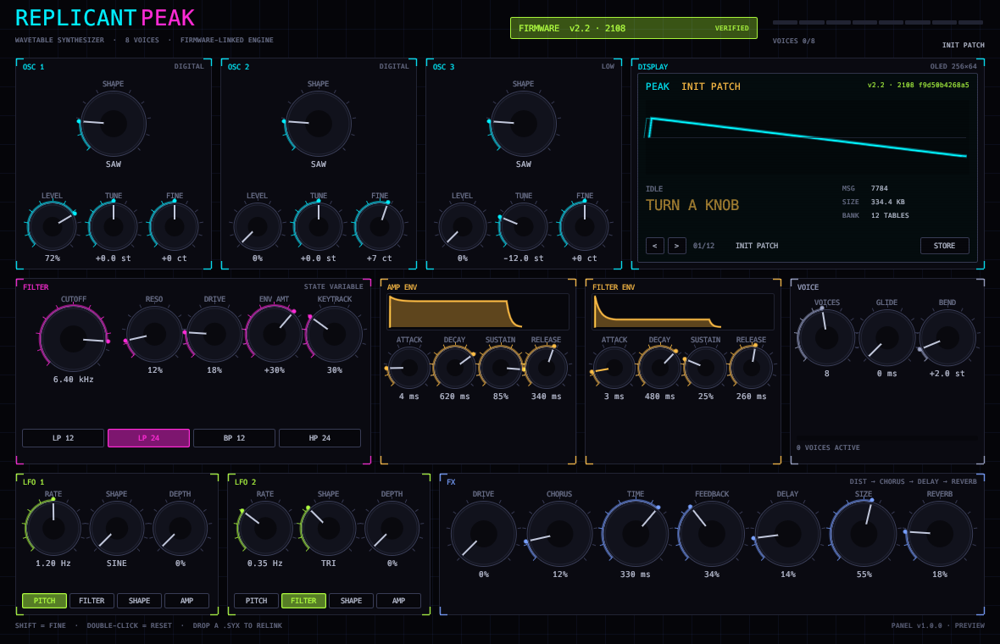

# ReplicantPeak

[](https://github.com/DanimanX/ReplicantPeak/actions/workflows/ci.yml)
[](https://github.com/DanimanX/ReplicantPeak/actions/workflows/release.yml)



A three-oscillator wavetable synthesizer inspired by the Novation Peak, written
in Rust and shipped as a **VST3 / CLAP** plugin plus a standalone panel that
renders exactly the same interface.

The engine stays silent until a genuine Peak firmware image (`.syx`) is linked.
That image is never executed or downloaded by the plugin: it is validated, used
as the build fingerprint, and used as the deterministic seed for the user
wavetables.

- **Status**: v1.0.0, first release.
- **License**: MIT for the code. The firmware is not included and not covered by
  that license (see [Firmware](#firmware)).

## What is inside

- Peak-style panel drawn with egui: three oscillator columns, centre display,
  filter, two envelopes, LFOs, FX and the voice section.
- An 8-voice engine (up to 16) with three wavetable oscillators, noise, ring
  modulation, a resonant state-variable filter with its own envelope, two LFOs
  and a serial FX chain (distortion, chorus, delay, reverb).
- 47 parameters shared by the engine, the host and the panel from a single
  table, so the ranges cannot drift apart.
- Firmware gate: without a valid image the plugin is silent and the editor
  draws the locked panel.
- Mip-mapped wavetable bank: 8 factory tables and 4 user tables derived from the
  SHA-256 of the linked firmware.

## Crates

- `crates/peak-core` — firmware validation, parameter table, wavetable bank and
  the DSP engine. No GUI or plugin framework, so it can be tested and
  benchmarked in isolation.
- `crates/peak-ui` — the panel and the `PanelHost` trait, the only way the
  interface talks to the outside world.
- `crates/peak-plugin` — NIH-plug host adapter: parameters, editor,
  allocation-free `process()`, firmware link persistence.
- `crates/peak-panel` — binary that opens the same panel without an audio
  device. It renders `assets/panel.png`.
- `xtask` — plugin bundling (`cargo xtask bundle`).

## Build and run

Rust 1.80 or newer. On Linux the panel needs the usual X11/Wayland development
headers for egui/winit.

```
cargo build -p peak-plugin      # the CLAP probe dlopens this cdylib
cargo test --workspace          # 52 tests: engine, firmware, presets, panel, host
cargo run -p peak-panel         # open the panel (no audio)
```

Plugin:

```
cargo xtask bundle peak-plugin --release
# bundles land in target/bundled/
```

README screenshot (needs `xvfb-run` when there is no display):

```
scripts/screenshot.sh            # -> assets/panel.png
```

## Presets

The display holds the preset browser: `<` and `>` step through the bank and
`STORE` writes the current parameters as a user preset. The bank is the 12
factory presets (`INIT PATCH`, `PEAK BASS`, `WIDE SAW STACK`, `GLASS PAD`,
`FM BELL`, `RING METAL`, `ACID LEAD`, `SUB PLUCK`, `NOISE SWEEP`,
`WARM CHORDS`, `TAPE KEYS`, `HOLLOW FIFTHS`) followed by whatever the user has
saved. Loading a preset goes through the host as one parameter gesture per
control, so it is captured by automation and undo like a knob move.

User presets are JSON files in:

- Linux: `$XDG_DATA_HOME/ReplicantPeak/presets` (or `~/.local/share/...`)
- macOS: `~/Library/Application Support/ReplicantPeak/presets`
- Windows: `%APPDATA%\ReplicantPeak\presets`

**These are patches for this engine, not the Peak's factory bank.** Novation
ships its factory patches as a separate bank download in Components (see the
1.1 and 1.2 release notes in `firmware/release-notes/`), and the firmware
`.syx` contains no patch records: its 7,784 messages are one 15-byte header plus
7,783 fixed 44-byte firmware frames (`F0 00 20 29 00 72 ... F7`), and a scan of
the payload finds no preset names or parameter blocks — only code.

## Plugin formats

| Format | Linux | Windows | macOS |
| --- | --- | --- | --- |
| VST3 | yes | yes | yes |
| CLAP | yes | yes | yes |
| AU | — | — | not available |

**Audio Unit is not offered, and that is a framework limit rather than a TODO.**
NIH-plug (the pinned revision, and upstream today) only implements VST3 and CLAP
wrappers; there is no AU export to call. Logic and other AU-only hosts can load
the VST3 build through a wrapper. Adding real AU support means replacing the
plugin adapter, not adding a CI leg, so the matrix deliberately has no AU entry.

Every release is built on GitHub-hosted runners for all three platforms and
attached as one archive per format:

```
ReplicantPeak-<version>-<os>-clap.zip
ReplicantPeak-<version>-<os>-vst3.zip
```

Unzip and copy the bundle into your plugin directory. The macOS builds are
unsigned, so Gatekeeper needs the usual manual approval
(<https://disable-gatekeeper.github.io/>).

## The firmware gate

The plugin starts locked and silent. Linking the Peak firmware `.syx` unlocks
it:

- drag the file onto the panel, or
- type its path into the lock screen field, or
- set `PEAK_FIRMWARE=/path/to/firmware.syx` for the standalone panel.

MIDI note input is declared by the plugin (`MidiConfig::Basic`), so hosts
deliver notes, pitch bend and all-notes-off; a note-on with velocity 0 is
treated as a note-off. Note events are applied at the start of each audio block
rather than sample-accurately.

Validation is strict: SysEx framing (`F0`…`F7`), Novation's manufacturer id
`00 20 29`, product byte `0x71` (firmware) or `0x7C` (FPGA) and a minimum
message count. The resulting SHA-256 is compared against the known-build table
in `crates/peak-core/src/firmware.rs`, so the panel reports `VERIFIED` or
`UNVERIFIED` instead of trusting a filename.

The link path is saved with the project state, so reopening a session revalidates
in the background and the instrument makes sound without asking again. The path
is saved; the firmware contents are not.

## Firmware

The `.syx` files are Focusrite/Novation property. They are not in this
repository: `firmware/` is ignored by git, and every checkout fetches its own
copy from the official channel with

```
scripts/fetch-firmware.sh          # downloads and verifies firmware 2.2 + FPGA 2.1
scripts/fetch-firmware.sh --list   # Peak builds published in the catalogue
```

The script pins the catalogue ids and the expected SHA-256 of each image (the
same hashes the engine knows), so a truncated or substituted download fails
there instead of inside the plugin. It also writes `firmware/SHA256SUMS`, which
can be rechecked at any time:

```
sha256sum -c firmware/SHA256SUMS
```

### How it was obtained

The Components updater does not serve the binary from the app itself: the app
fetches a public catalogue and then downloads the file by id.

```
GET https://components.novationmusic.com/api/v2/firmwares              # JSON catalogue, no auth
GET https://components.novationmusic.com/api/v2/firmwares/155/file     # firmware v2.2
GET https://components.novationmusic.com/api/v2/firmwares/142/file     # FPGA v2.1
```

Both responses are `302` redirects to a pre-signed S3 URL (valid for 7 days),
with no cookies, tokens or device check. There was no need to emulate WebMIDI or
a virtual Peak: the "connect the instrument" gate lives in the UI flow only, not
in the file delivery.

### What was verified

- HTTP 200 after the signed redirect to `circuit-librarian.s3.eu-west-1.amazonaws.com`
- Downloaded size == `Content-Length` (342,467 and 3,068,144 bytes)
- Valid SysEx: Novation manufacturer id `00 20 29`, well-formed messages
  (`F0`…`F7`), 0 framing errors, 100% 7-bit payload (7,784 messages in the
  firmware, 4,679 in the FPGA)
- All 10 Peak builds the catalogue serves were downloaded and their SHA-256
  match `KNOWN_BUILDS`. The catalogue's v1.1/build 262 returns `500` and is
  therefore absent from the table.
- `sha256sum -c firmware/SHA256SUMS` revalidates at any time

### Version pairing

The catalogue only lists two FPGA families for the Peak: v2.0/build 439 and
v2.1/build 469. The newest published FPGA is 2.1 (build 469), and the 2.2 notes
announce no FPGA change, so the correct pair for v2.2 is **firmware 2108 +
FPGA 469**. If your unit is on v1.x and you upgrade to v2.x, the FPGA has to be
updated as well.

### Installing on the hardware

1. The usual way: connect the Peak over USB and use
   <https://components.novationmusic.com> (Chrome/Edge, WebMIDI), which sends
   these same `.syx` files.
2. Manual: send the `.syx` as a SysEx dump over USB-MIDI (for example
   `amidi -p hw:X,Y -s file.syx`, or SysEx Librarian / MIDI-OX), starting with
   the FPGA if you are coming from v1.x and then the firmware. Do not interrupt
   the transfer.
3. After upgrading to v2.2, restart the unit if the panel controls do not
   respond (as stated in the release notes).

## Origin and date

Catalogue queried on 2026-10-23 against `components.novationmusic.com`
(frontend `1.72.5+1798590e`). Novation, Peak and Focusrite are trademarks of
their respective owners; this project is neither affiliated with nor endorsed by
them. The name and the panel layout are a tribute, not a replica of the
hardware.

## License

MIT for the code; see [LICENSE](LICENSE). Downloaded firmware falls outside that
license and remains Focusrite/Novation property.
